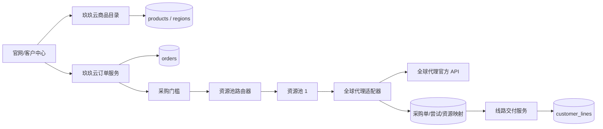
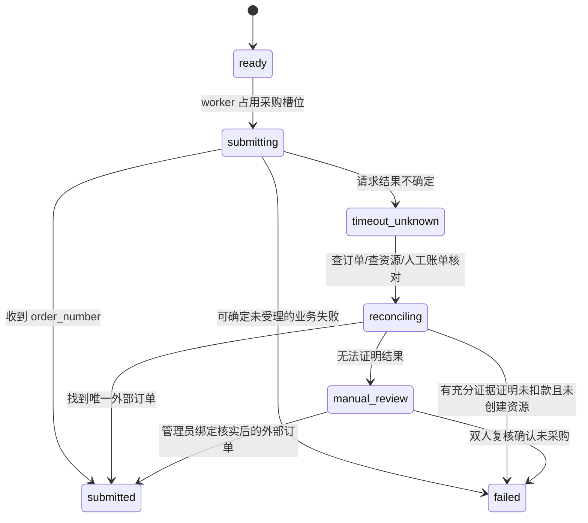
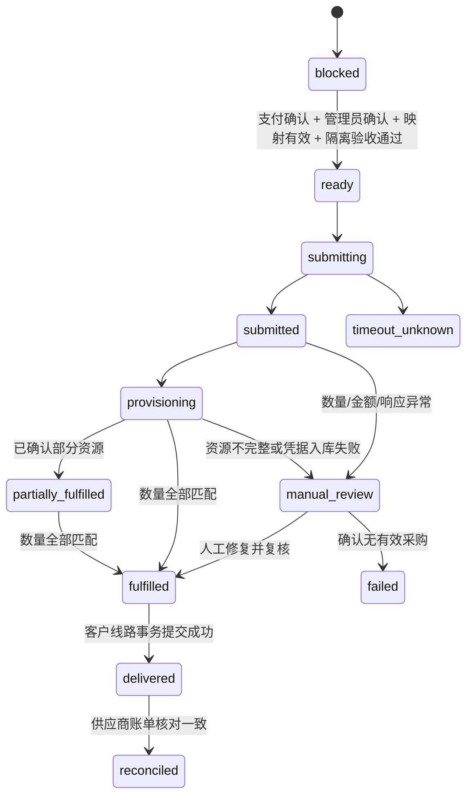
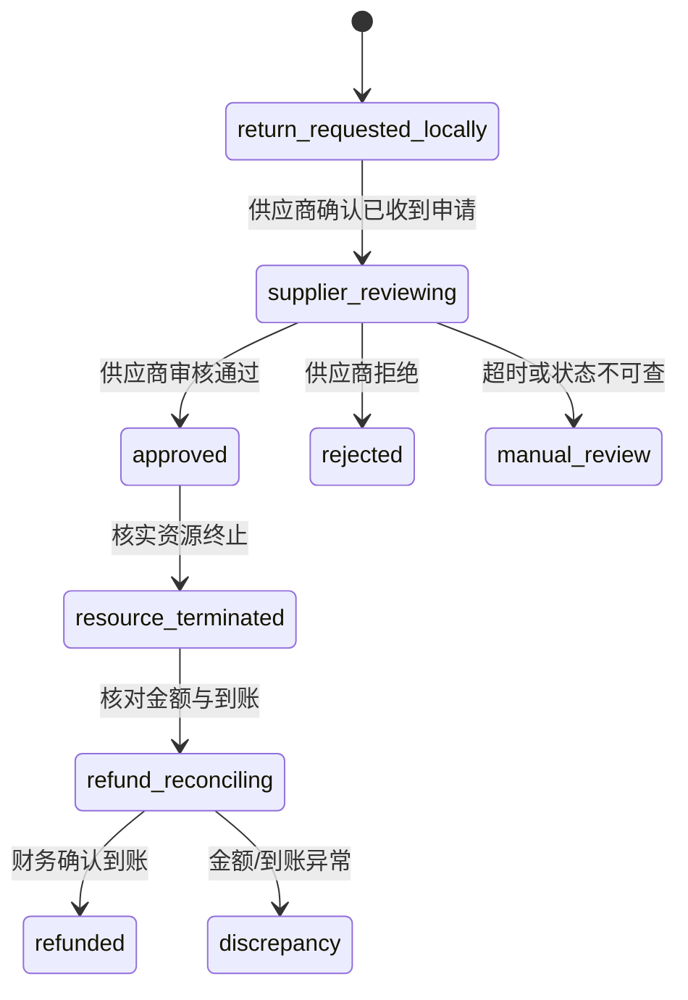

# 多供应商资源池架构设计

> 状态：架构设计，尚未实施  
> 核对日期：2026-10-27  
> 范围：只定义多供应商资源池、全球代理（资源池 1）接入边界、数据模型/迁移方案、状态流转和测试方案。本阶段没有创建迁移、修改运行代码、调用供应商采购接口或启用自动采购。

## 1. 结论与启用边界

推荐采用“玖玖云商品主数据 + 资源池路由 + 供应商适配器 + 独立采购单”的四层结构：

1. 官网继续只展示玖玖云自己的 `products`、`regions` 和销售价格，不直接展示供应商目录、成本或库存明细。
2. `orders` 和 `customer_lines` 保持供应商无关，不增加“全球代理专用字段”。
3. 资源池 1 的内部代码建议为 `global_proxy_pool`，首个供应商适配器为 `quanqiudaili`。资源池和供应商是两个概念，后续一个资源池可按优先级、健康度和地区容纳多个供应商。
4. 产品和地区通过显式映射及供应规则关联。无有效映射、库存过期、报价过期或规则未启用时，一律转人工，不猜测供应商参数。
5. 自动采购默认且强制关闭：`SUPPLIER_AUTO_PROCUREMENT_ENABLED=false`。在支付/管理员确认门槛、供应商沙箱或书面认可的隔离测试、超时查单和失败补偿均通过验收前，不允许打开。
6. 供应商 API Key 仅从环境密钥读取。数据库最多保存环境变量名或密钥管理器引用，禁止保存密钥值；代码、日志、通知、审计和异常正文均不得出现 Key、代理密码、订阅链接或节点凭据。

## 2. 全球代理官方 API 核对

### 2.1 文档来源与核对方法

已核对以下公开官方入口，只读取公开文档页面，没有携带 API Key，也没有调用商品查询、报价、库存、购买或退单业务接口：

- 官方网站：<https://www.quanqiudaili.com/>
- 官方开发者文档：<https://develop.quanqiudaili.com/>
- 官方机器可读目录：<https://develop.quanqiudaili.com/llms.txt>
- API 文档说明：<https://develop.quanqiudaili.com/5263348m0.md>
- API Key 获取方式：<https://develop.quanqiudaili.com/9518262m0.md>
- 文档声明的正式服务地址：`https://admin.quanqiudaili.com`

公开文档会变化。实际接入前必须固定文档版本或保存经过法务和安全允许的契约快照，并在测试环境重新做契约测试。本设计不把文档示例数据视为真实库存或价格。

### 2.2 认证与通用协议

| 项目 | 官方文档确认结果 | 适配要求 |
| --- | --- | --- |
| 认证 | 请求头 `token`；可使用登录 Token 或 `sk-` 格式 API Key；不加 `Bearer` | 生产只允许独立、最小权限 API Key；适配器负责注入，业务层不可接触密钥 |
| 服务地址 | `https://admin.quanqiudaili.com` | 基础地址使用配置白名单，不允许由请求参数覆盖 |
| 请求体 | 写接口使用 `application/x-www-form-urlencoded` | 适配器内编码；内部领域对象不暴露表单字段名 |
| 成功语义 | 常见为 HTTP 200 且响应体 `code=1` | 必须同时判断 HTTP 状态、JSON 可解析性和业务 `code` |
| 业务失败 | 常见为 HTTP 200 且 `code=0` | 映射成稳定的内部错误码，供应商原始消息只做脱敏后受控保存 |
| 鉴权失败 | 部分新文档列出 HTTP 401 | 不自动重试；立即熔断该供应商凭据并告警 |
| 敏感响应 | 子账号接口/购买响应可含 `target`、`port`、`username`、`password`、`ip` | 只能进入受控加密秘密存储；不得进入普通业务表、日志、通知和审计详情 |

### 2.3 能力矩阵

| 能力 | 已核对接口 | 方法 | 结论与限制 |
| --- | --- | --- | --- |
| 商品目录 | `/externalapi/conpons/getProductList` | GET | 返回产品类型。文档列出 1 动态住宅按流量不限时长、2 静态住宅普通、3 静态住宅原生、4 运营商原生、6 动态住宅包月、8 静态数据中心；其他页面还包含产品 11 动态住宅不限流量。目录仅用于供应商映射，不能直接成为官网商品 |
| 用户报价 | `/externalapi/product_price/getProductUnitPrice` | GET | 产品 1/2/3/4/6/8 返回用户单价表；产品 11 支持首购/续费试算。报价不锁价、不扣款、不占库存，下单会重新计价；金额单位为人民币元 |
| 国家 | 产品 2：`/externalapi/inventory/countryList?product_type_id=2` | GET | 返回供应商国家 ID、名称、二字码。其他产品有各自官方文档，启用前逐产品做契约测试 |
| 城市 | 产品 2：`/externalapi/inventory/cityList` | GET | 可按 `country_id` 或 `country_code` 查询；两者同传必须属于同一国家 |
| 地区库存摘要 | 产品 2：`/externalapi/inventory/getBuyProductSku` | GET | 返回国家/城市和 `sku_status`（0 充足、1 紧缺），不是可承诺数量 |
| 购买前库存检测 | 产品 2：`/externalapi/product_order/checkInventory` | POST | 表单包含 `product_type_id`、`num`、`country` 等；返回 `is_sufficient` 及指定网段结果。检测不占库存，不能替代下单结果 |
| 静态普通购买 | `/externalapi/product_order/createProductBuyOrder` | POST | 产品 2 必填 `product_type_id`、`num`、`timelen`、`agree`、`country`；`num` 文档范围 1-300；返回 `order_number` 和带凭据的 `sub_accounts`；库存不足示例为 `code=0` |
| 动态流量购买 | `/externalapi/product_order/createProductBuyOrder` | POST | 产品 1 必填 `product_type_id=1`、`num`（GB，文档范围 1-300）；购买的是主账号流量，与创建客户子账号是不同操作 |
| 动态不限流量购买 | `/externalapi/product_order/createProductBuyOrder` | POST | 产品 11 必填时长档、国家和带宽；公开文档当前列出 US/DE/SG，带宽为 10 的倍数且范围 10-1000 Mbps |
| 订单查询 | `/externalapi/product_order/getOrderProductBuyDetails` | GET | 按订单 ID 或 `orderNumber` 查询；同时传入时优先 ID。返回展示型的类型、数量、详情、金额、支付方式，不含可靠的扣款/交付状态；`code=1` 仅表示查询成功 |
| 已购资源查询 | 例如产品 2：`/externalapi/device/accountList` | GET | 分页最大 100，可按国家、ID、IP、备注等过滤；含资源状态、到期时间、原购买订单 ID，也包含敏感连接凭据 |
| 静态普通退单 | `/externalapi/order_back/createOrderBack` | POST | 提交 `order_product_buy_id`、`ids[]`、`remark`。成功响应仅表示“退单申请已提交”；审核通过后资源会删除或终止且不可恢复 |
| 产品 11 退单 | `/externalapi/order_back/createOrderBack` | POST | 按原订单提交申请；同样是人工审核语义，不代表退款成功 |
| 购买续费 | 产品 2 和产品 11 均有独立续费文档 | POST | 属于未来能力；必须使用既有资源映射并重新报价，不复用首次购买命令 |
| 未交付订单取消 | 未在已核对公开目录中找到明确接口 | - | 不能宣称支持取消。接入前向供应商书面确认 |
| 自动退款/退款到账查询 | 未在已核对公开目录中找到明确接口 | - | 退单申请不等于退款。退款金额、审核结果、原路退回和到账状态均需书面契约或人工对账 |
| API 限流 | 99 篇公开 Markdown 未发现调用频率、QPS、HTTP 429 或 `Retry-After` 的明确规则 | - | 不猜测数值。上线前必须取得书面限制；客户端仍实施保守的本地并发上限、超时、退避和熔断，但不得把它描述为供应商官方限额 |

关键官方页面：

- 商品目录：<https://develop.quanqiudaili.com/222490578e0.md>
- 用户报价：<https://develop.quanqiudaili.com/389339469e0.md>
- 产品 2 国家/城市：<https://develop.quanqiudaili.com/222487309e0.md>、<https://develop.quanqiudaili.com/222487647e0.md>
- 产品 2 库存摘要/检测：<https://develop.quanqiudaili.com/309085305e0.md>、<https://develop.quanqiudaili.com/458545749e0.md>
- 产品 2 购买/资源查询/退单：<https://develop.quanqiudaili.com/222033956e0.md>、<https://develop.quanqiudaili.com/222488103e0.md>、<https://develop.quanqiudaili.com/386072997e0.md>
- 产品 1 购买：<https://develop.quanqiudaili.com/222033932e0.md>
- 产品 11 购买/退单：<https://develop.quanqiudaili.com/518829781e0.md>、<https://develop.quanqiudaili.com/518878355e0.md>
- 订单详情：<https://develop.quanqiudaili.com/524702701e0.md>

### 2.4 文档歧义和接入阻塞项

1. 部分 OpenAPI 页面在操作级写 `security: []`，但参数又明确要求 `token`。实现以必传 `token` 为准，并通过隔离环境验证，不能把 `security: []` 解释为匿名访问。
2. 产品 2 购买页的描述说产品 ID 固定为 2，但示例值出现 3。这是文档不一致；适配器必须由映射固定传 2，不能采用示例值。
3. 订单详情是展示项数组且明确不含可靠交付状态，不能单独承担超时补偿。必须结合外部订单号、资源列表中的原订单 ID和人工账单核对。
4. 库存摘要只有“充足/紧缺”，购买前检测也不锁库存；官网不能承诺实时有货。
5. 未公开声明接口限流、服务等级、幂等键、Webhook、退款到账查询和沙箱地址，这些都是启用自动采购前的阻塞项。

## 3. 领域边界



职责划分：

| 边界 | 负责 | 不负责 |
| --- | --- | --- |
| 商品目录 | 玖玖云商品、地区、销售价、上下架 | 供应商成本、账号、实时库存 |
| 供应规则 | 产品/地区到资源池的可用性、优先级、人工/自动策略 | 直接发起供应商请求 |
| 资源池路由器 | 在有效规则内选择供应商映射，冻结选择结果 | 拼接供应商表单、解析供应商响应 |
| 供应商适配器 | 认证注入、字段映射、请求/响应解析、错误归一化 | 修改客户订单状态、决定售价 |
| 采购编排 | 幂等、状态机、重试、超时查单、补偿、转人工 | 向官网暴露凭据 |
| 线路交付 | 将已确认的供应商资源绑定客户线路 | 重新下单或推断采购是否成功 |

### 3.1 适配器契约

建议用稳定领域对象隔离外部 API，接口不返回供应商原始字典：

```python
class SupplierAdapter(Protocol):
    def list_products(self) -> list[SupplierProduct]: ...
    def list_regions(self, product_ref: str) -> list[SupplierRegion]: ...
    def quote(self, request: QuoteRequest) -> QuoteResult: ...
    def check_inventory(self, request: InventoryRequest) -> InventoryResult: ...
    def purchase(self, request: PurchaseRequest) -> PurchaseResult: ...
    def get_order(self, supplier_order_ref: str) -> SupplierOrderResult: ...
    def list_resources(self, query: ResourceQuery) -> list[SupplierResourceResult]: ...
    def request_return(self, request: ReturnRequest) -> ReturnRequestResult: ...
```

约束：

- `PurchaseRequest` 只能由采购编排器创建，必须包含内部 `procurement_order_id`、幂等键、已冻结的商品/地区映射、数量、周期和协议。
- 适配器从 `secret_ref` 对应的环境变量读取 Key，并在发送前注入 `token`；任何对象的 `repr`、异常或结构化日志都必须排除请求头。
- `PurchaseResult` 将外部订单号、实际扣费和资源数量分开表达。连接凭据返回 `secret_payload`，立即加密落入专用秘密存储后从内存对象释放。
- 原始响应若确有排障需要，只能保存字段白名单和哈希；禁止整包持久化购买/子账号响应。
- 适配器错误统一为 `AUTH_FAILED`、`INVALID_MAPPING`、`OUT_OF_STOCK`、`RATE_LIMITED`、`TIMEOUT_UNKNOWN`、`UPSTREAM_REJECTED`、`MALFORMED_RESPONSE`、`UNAVAILABLE`，不得用供应商中文消息驱动状态机。

## 4. 商品、地区和供应路由

### 4.1 官网商品不变

官网的 `GET /api/public/products` 和 `GET /api/public/regions` 继续读取玖玖云 `products`/`regions`。价格预览和客户订单仍使用数据库销售价，前端不能提交成本价、供应商 ID、资源池 ID或采购参数。

供应来源仅作为后台配置：

```text
玖玖云 product + region
  -> product_supply_rule
  -> resource_pool (资源池 1)
  -> resource_pool_supplier
  -> supplier_product + supplier_region
```

推荐“精确地区规则优先，产品默认规则兜底”。禁止自动退化到任意国家、任意城市或另一个产品类型。

### 4.2 资源池 1 初始配置

| 配置 | 初始值 |
| --- | --- |
| `resource_pools.code` | `global_proxy_pool` |
| 展示名 | `资源池 1` |
| 首个供应商 | `quanqiudaili` |
| 自动采购 | 关闭 |
| 官网可见性 | 不直接可见 |
| 默认供应范围 | 只允许后台逐个启用的玖玖云产品 + 地区组合 |
| 无库存/过期库存 | 转人工，不自动跨地区 |
| 供应商切换 | 默认禁止自动切换；必须先证明前一次未扣款且未创建资源 |

## 5. 数据模型与迁移方案

当前迁移 head 为 `0009_remove_redundant_delivery_fk`。实施时新增后继迁移，例如 `0010_supplier_resource_pools`，不得修改 `0001` 至 `0009`。

### 5.1 新表

| 表 | 关键字段 | 约束/用途 |
| --- | --- | --- |
| `suppliers` | `id`, `code`, `name`, `adapter_type`, `base_url`, `secret_ref`, `status`, `auto_purchase_enabled`, `created_at`, `updated_at` | `code` 唯一；`secret_ref` 仅保存环境变量名/密钥引用；生产基础地址白名单 |
| `resource_pools` | `id`, `code`, `name`, `status`, `strategy`, `created_at`, `updated_at` | `code` 唯一；首期策略为 `priority_manual_fallback` |
| `resource_pool_suppliers` | `pool_id`, `supplier_id`, `priority`, `weight`, `is_enabled` | 联合唯一；首期只有全球代理，`weight` 预留但不启用随机路由 |
| `supplier_products` | `id`, `supplier_id`, `external_product_ref`, `name_snapshot`, `billing_model`, `currency`, `capabilities_json`, `is_active`, `last_synced_at` | `(supplier_id, external_product_ref)` 唯一；JSON 只存非敏感能力 |
| `supplier_regions` | `id`, `supplier_id`, `supplier_product_id`, `external_country_ref`, `country_code`, `external_city_ref`, `city_name`, `is_active`, `last_synced_at` | 用供应商 ID/code 原样映射；禁止模糊匹配后自动采购 |
| `product_supply_rules` | `id`, `product_id`, `region_id`, `pool_id`, `supplier_product_id`, `supplier_region_id`, `priority`, `mode`, `is_enabled`, `valid_from`, `valid_until` | `(product_id, region_id, priority)` 唯一；`mode=manual/assisted/automatic`，首期仅 `manual` |
| `supplier_quotes` | `id`, `supplier_id`, `supplier_product_id`, `supplier_region_id`, `request_hash`, `quantity`, `duration_value`, `duration_unit`, `unit_cost`, `total_cost`, `currency`, `quoted_at`, `expires_at`, `raw_hash` | 成本报价快照；金额建议 `NUMERIC(18,4)`，不用二进制浮点 |
| `supplier_inventory_snapshots` | `id`, `supplier_id`, `supplier_product_id`, `supplier_region_id`, `availability`, `available_quantity`, `checked_at`, `expires_at`, `source` | 未提供数量时 `available_quantity=NULL`；`availability=available/tight/unavailable/unknown` |
| `procurement_orders` | `id`, `order_id`, `pool_id`, `supplier_id`, `supplier_product_id`, `supplier_region_id`, `status`, `requested_quantity`, `fulfilled_quantity`, `idempotency_key`, `supplier_order_ref`, `sales_unit_price_snapshot`, `sales_total_snapshot`, `cost_unit_snapshot`, `cost_total_snapshot`, `currency`, `mapping_snapshot_json`, `next_action_at`, `failure_code`, `manual_reason`, `version`, timestamps | `idempotency_key` 唯一；每次冻结供应选择和价差；乐观版本或行锁保护并发 |
| `procurement_attempts` | `id`, `procurement_order_id`, `attempt_no`, `operation`, `request_fingerprint`, `status`, `started_at`, `finished_at`, `http_status`, `supplier_code`, `error_code`, `response_hash`, `correlation_id` | `(procurement_order_id, operation, attempt_no)` 唯一；不存头、表单原文和敏感响应 |
| `supplier_resources` | `id`, `procurement_order_id`, `customer_line_id`, `supplier_id`, `external_resource_ref`, `external_order_ref`, `status`, `region_snapshot_json`, `started_at`, `expires_at`, `credential_secret_ref`, `last_synced_at` | `(supplier_id, external_resource_ref)` 唯一；`credential_secret_ref` 指向加密秘密，不是明文 |
| `supplier_sync_runs` | `id`, `supplier_id`, `sync_type`, `status`, `started_at`, `finished_at`, `items_seen`, `items_changed`, `error_code`, `cursor` | 目录、地区、库存、资源状态同步的运行记录 |
| `supplier_reconciliations` | `id`, `supplier_id`, `period_start`, `period_end`, `status`, `internal_count`, `supplier_count`, `internal_amount`, `supplier_amount`, `difference_amount`, `result_json`, `reviewed_by`, timestamps | 对账只保存非敏感差异；异常必须人工确认 |

### 5.2 现有表扩展

| 表 | 建议字段 | 原因 |
| --- | --- | --- |
| `orders` | 不直接增加 `supplier_id`；可增加 `procurement_status` 的只读汇总字段，或运行时聚合 | 一个订单可能分批、跨尝试甚至未来跨供应商采购，单外键会错误绑定 |
| `customer_lines` | 不直接保存供应商凭据；可增加唯一的 `supplier_resource_id`（实现时选择外键方向，避免循环外键） | 线路仍是客户领域对象，供应商细节由 `supplier_resources` 隔离 |
| `audit_logs` | 可增加 `correlation_id`、`metadata_json`（白名单） | 串联订单、采购、交付和对账；严禁写敏感字段 |

外键建议由 `supplier_resources.customer_line_id` 单向引用 `customer_lines.id`，不要同时让 `customer_lines` 再外键回指，避免重现循环外键问题。未交付资源允许 `customer_line_id=NULL`。

### 5.3 索引、约束和迁移顺序

1. 先建 `suppliers`、`resource_pools`、映射及供应规则，再建采购和同步表。
2. 对 `idempotency_key`、外部资源复合键、外部订单号、同步时间、状态/待处理时间建立索引。
3. 增加检查约束：数量大于 0、已履约量在 0 到请求量之间、成本非负、自动模式只能引用启用映射。
4. PostgreSQL 使用部分唯一索引确保同一玖玖云订单同一交付单元只有一个非终态采购；SQLite 测试可用普通唯一业务键模拟，但 PostgreSQL 必须单独验收。
5. `upgrade` 只创建空配置，不写 API Key、不自动启用资源池、不回填供应商；`downgrade` 按外键逆序删除。
6. 当前 `orders.amount/unit_price/total_amount` 仍为 `Float`。本阶段不顺带做全局金额迁移；正式采购前应在财务阶段统一迁移为定点金额。新供应商表推荐从一开始使用 `NUMERIC(18,4)`。

## 6. 价格、库存与快照

### 6.1 价格分层

| 层 | 来源 | 何时冻结 | 用途 |
| --- | --- | --- | --- |
| 官网销售价 | 玖玖云 `products.price` 和自身计价规则 | 客户创建订单时 | 客户应付价格，不受供应商实时价格直接驱动 |
| 供应商参考价 | `supplier_quotes` | 预采购评估时 | 毛利检查和采购审批，不对客户公开 |
| 实际采购成本 | 供应商下单响应/对账 | 每次采购尝试确认成功后 | 成本、对账、利润分析 |
| 订单销售快照 | 现有订单单价/总价/商品/地区快照 | 下单时 | 防止后续商品改价影响历史订单 |

采购前如果最新报价超过配置的最大成本或导致毛利低于阈值，状态转 `manual_review`，不得自行提高客户价格或继续采购。报价与下单价可能不同，最终成本以供应商已确认订单和对账为准。

### 6.2 库存同步

- 目录/地区建议低频同步；库存按产品/地区采用短 TTL，具体周期通过压测和供应商书面限流确定，当前不写死数值。
- 每条库存必须记录 `checked_at` 和 `expires_at`。官网只能显示“可下单/需确认”等玖玖云语义，不展示供应商内部数量或品牌。
- 库存过期视为 `unknown`；下单前必须再次调用购买前检测，但检测成功也不保证购买成功。
- 同步失败保留上次快照用于审计，但不可把过期快照用于自动采购。

## 7. 幂等、并发、超时与重试

### 7.1 幂等

- 内部键建议：`sha256(order_id + delivery_slot + mapping_version + operation)`，由服务端生成，客户端不得传入。
- 在数据库事务中先创建唯一的 `procurement_orders`，再由事务外 worker 执行供应商调用；不得持有数据库事务跨网络请求。
- 使用 `SELECT ... FOR UPDATE` 或原子条件更新占用采购槽位，确保并发任务不会超过订单 `quantity`。
- 全球代理公开文档未声明支持幂等请求头，因此内部幂等只能阻止本系统重复发起，不能证明网络超时后供应商未受理。

### 7.2 重试分类

| 场景 | 策略 |
| --- | --- |
| 连接建立前失败且可证明请求未发送 | 指数退避 + 抖动，受有限次数和总时限约束 |
| 429 | 仅在实际响应出现时尊重 `Retry-After`；无该头则进入受控退避/熔断，规则需接入验收确认 |
| 5xx 且操作为只读查询 | 有界重试 |
| 401/403、参数错误、库存不足、业务 `code=0` | 不重试；修配置或转人工 |
| 购买请求发送后超时/连接中断 | 标记 `timeout_unknown`，禁止自动重试购买 |
| 退单申请超时 | 标记未知并人工核对，禁止重复提交直至确认状态 |

### 7.3 超时未知的处理



严禁 `timeout_unknown -> 自动重新购买`。订单详情接口若没有外部订单号无法查单，且其响应不含可靠交付状态，因此还必须按请求时间窗、商品、数量、金额和资源列表做人工关联；查无结果本身也不足以证明可以重买。

## 8. 采购与退单状态

### 8.1 采购主流程



门槛必须同时满足：

1. 玖玖云订单状态允许采购，支付状态有可靠来源且已确认；
2. 管理员显式确认采购，或未来审批策略明确授权；
3. 产品、地区、数量、周期映射完整且版本已冻结；
4. 报价/库存未过期，成本和毛利规则通过；
5. 供应商、资源池、规则、worker 和全局开关均启用；
6. 沙箱或供应商认可的隔离测试、超时查单、凭据加密和补偿演练均通过。

当前支付、沙箱和补偿门槛不完整，所以所有订单止于 `blocked/manual`，由现有管理员手动交付流程处理。

### 8.2 退单/退款流程



不得把供应商返回“退单申请已提交”写成玖玖云订单 `refunded`。在供应商没有退款状态/金额 API 的情况下，`approved` 和 `refunded` 必须由后台凭证与双人复核推进。

## 9. 内部 API 与后台任务清单

本节是后续实现清单，不代表接口现已存在。

### 9.1 管理 API

| API | 作用 | 权限 |
| --- | --- | --- |
| `GET /api/admin/suppliers` | 查看供应商状态、能力和最后同步时间，不返回密钥 | 管理员/超级管理员 |
| `PATCH /api/admin/suppliers/{id}` | 启停、设置密钥引用和人工/自动策略 | 超级管理员；敏感变更双人复核 |
| `GET/POST/PATCH /api/admin/resource-pools` | 管理资源池及成员优先级 | 超级管理员 |
| `GET/POST/PATCH /api/admin/supply-rules` | 配置玖玖云产品/地区映射 | 管理员编辑，超级管理员启用 |
| `POST /api/admin/suppliers/{id}/sync` | 触发目录/地区/库存只读同步 | 管理员；限频且审计 |
| `GET /api/admin/procurements` | 按状态、订单、供应商、外部单号筛选 | 管理员/超级管理员 |
| `POST /api/admin/procurements/{id}/approve` | 满足门槛后批准采购 | 双人复核策略 |
| `POST /api/admin/procurements/{id}/reconcile` | 触发只读核对 | 管理员 |
| `POST /api/admin/procurements/{id}/resolve` | 处理未知结果/绑定外部单 | 超级管理员，必填说明 |
| `POST /api/admin/procurements/{id}/request-return` | 提交退单申请 | 超级管理员，二次确认 |

管理请求只能引用玖玖云实体 ID；外部产品、地区和供应商由已启用映射解析，防止越权篡改供应来源。销售和客户无权访问这些 API。

### 9.2 后台任务

- `sync_supplier_catalog`：商品和地区只读同步。
- `sync_supplier_inventory`：库存快照同步及过期标记。
- `refresh_supplier_quotes`：后台成本报价，不影响官网销售价。
- `execute_procurement`：只处理已通过门槛的唯一采购单。
- `reconcile_unknown_procurement`：只读查单/查资源，不自动重买。
- `sync_supplier_resources`：到期时间和状态同步；凭据字段跳过普通日志。
- `reconcile_supplier_statement`：按账期生成差异，人工确认。
- `expire_stale_snapshots`：将过期报价/库存标为不可自动使用。

## 10. 安全、日志与审计

### 10.1 密钥与凭据

- 环境配置示例只写 `GLOBAL_PROXY_API_KEY` 变量名，不写值。生产由密钥管理器注入；进程启动只检查存在性，不输出长度、前后缀或哈希。
- 数据库 `suppliers.secret_ref` 可保存 `env:GLOBAL_PROXY_API_KEY`，禁止保存真实 Key。
- 供应商代理账号、密码和连接目标使用 envelope encryption 或外部秘密管理服务。加密主密钥不得与数据库同库保存。
- 客户接口按现有线路授权返回产品允许的最小数据；无真实交付数据时链接、订阅地址和二维码保持 `null`，不得生成假值。

### 10.2 日志和审计白名单

允许记录：内部订单 ID、采购单 ID、供应商代码、资源池代码、外部订单号的受控展示/哈希、状态、标准错误码、耗时、数量、金额币种、操作者和关联 ID。

禁止记录：`token` 请求头、API Key、请求表单原文、原始响应、`password`、`bindPassword`、`username`（若为连接凭据）、`target`、`port`、代理链接、订阅链接、二维码内容、Cookie/JWT。

必须审计：映射变更、供应商/自动采购启停、报价和库存手工覆盖、采购批准、外部单绑定、未知结果处置、退单申请、退款确认、凭据读取和对账确认。审计写入失败时，管理变更和采购操作整体失败。

## 11. 测试方案

### 11.1 单元与契约测试

| 类别 | 必测场景 |
| --- | --- |
| 适配器解析 | HTTP 200/code=1、HTTP 200/code=0、401、非 JSON、字段缺失、金额字符串/数字、未知字段 |
| 认证 | 仅从密钥提供器注入 `token`；日志捕获中不存在 Key；缺密钥安全失败 |
| 商品/地区 | 产品 ID 精确映射；国家二字码规范化；城市不做模糊自动匹配；停用映射不可路由 |
| 报价 | 销售价与供应商成本隔离；报价过期；下单成本变化；币种不一致转人工 |
| 库存 | 充足、紧缺、不足、未知、过期；库存检测成功后下单仍售罄 |
| 响应脱敏 | 购买/资源响应中的账号、密码、主机、端口、IP 不出现在日志、审计、通知和普通 API |
| 限流 | 429/Retry-After（模拟）；无官方数值时只验证客户端策略可配置，不宣称官方限制 |

契约测试必须使用录制后人工脱敏的固定样本或供应商认可的测试环境；禁止把生产 Key 放进 fixture。公开文档示例含虚构/演示凭据，也不得原样复制进测试日志。

### 11.2 幂等与故障注入

1. 同一订单/交付槽位并发 20 次，只创建一个采购单和一次可执行尝试。
2. worker 崩溃在“写尝试前、请求前、请求发送后、响应后、凭据加密前、线路事务前”各阶段的恢复。
3. 购买请求发送后超时进入 `timeout_unknown`，调度器不再次调用购买。
4. 查无订单不会自动改为可重试；只有人工或充分证据可解除。
5. 供应商返回资源数少于、等于、大于请求量：分别部分履约、成功、阻断并告警；绝不超额交付。
6. 凭据加密/秘密存储失败时不创建客户线路，采购单转人工且保留非敏感核对依据。
7. 数据库提交失败时采购结果不能丢失：通过尝试记录/对账重新发现，但不重复购买。

### 11.3 权限与业务测试

- 客户和销售不能读取供应商、成本、映射、采购单、对账及凭据管理 API。
- 管理员只能在授权范围操作；启用自动采购、未知结果处置和退款确认需要超级管理员/双人复核。
- 前端提交供应商 ID、成本、外部商品 ID、客户 ID 时被忽略或拒绝。
- 官网商品下架不删除历史订单快照；供应商映射变更不改变已冻结采购单。
- 一个客户无法借订单/线路 ID 查询另一个客户的供应商资源。
- 通知只包含玖玖云订单号、状态和非敏感说明，不含供应商品牌、成本或凭据。

### 11.4 数据库与端到端验收

- PostgreSQL 全新升级、`alembic check`、降级到 `0009`、再次升级；SQLite 只做兼容性辅助，不能替代 PostgreSQL。
- PostgreSQL 验证唯一幂等键、行锁/原子更新、部分唯一索引和并发采购槽位。
- 使用假的 `SupplierAdapter` 完成“订单确认 -> 人工批准 -> 部分/全部资源 -> 线路交付”闭环。
- 使用故障适配器完成超时未知、库存不足、鉴权失败、限流、畸形响应、退单待审核和对账差异。
- 最后才在供应商认可的隔离环境执行零金额或明确可撤销的测试；没有沙箱/书面授权时不执行真实购买。

## 12. 分阶段实施与启用门槛

### 阶段 A：只读接入

实现供应商、资源池、映射、商品/地区/报价/库存只读同步及管理页。所有供应规则为 `manual`，不实现购买 worker。验收密钥脱敏、契约解析和库存过期。

### 阶段 B：影子采购计划

根据真实玖玖云订单生成不可执行的采购计划，对比报价、库存和毛利，只供管理员审核。验证对账和告警，不发送购买请求。

### 阶段 C：人工触发采购

仅在支付确认和管理员二次确认后，由受控 worker 执行单笔采购。完成超时未知、加密凭据、部分履约、失败补偿和退单审核演练。

### 阶段 D：受限自动采购

只有以下条件全部满足才允许把单个供应规则切到 `automatic`：

- 支付确认来源可靠，管理员确认门槛和风控规则已实现；
- 供应商提供沙箱，或书面确认可执行的隔离测试方案并已通过；
- API 限流、服务等级、幂等/查单能力、取消和退款语义获得书面确认；
- 超时未知、部分履约、重复扣款、凭据入库失败和退单失败均有演练过的补偿手册；
- PostgreSQL 并发、事务、对账、审计、告警和密钥轮换验收通过；
- 全局开关、供应商开关、资源池开关、供应规则开关四级均开启。

任何一项不满足都保持人工模式。当前项目尚未实现在线支付、余额扣款、退款、真实线路采购和真实订阅交付，因此资源池 1 只能作为设计和未来只读接入目标，不能标记为可自动采购。

## 13. 本阶段交付说明

- 已完成：官方公开 API 文档核对、能力与不确定项清单、资源池/适配器边界、数据模型和迁移方案、API/任务清单、状态流转及测试方案。
- 未执行：供应商 API 业务调用、Key 配置、Alembic 迁移、模型或接口代码修改、生产/开发数据库访问、自动采购、在线支付、退款或真实线路交付。
- 下一阶段推荐先实施“阶段 A：只读接入”，原因是它可以验证协议、映射和敏感数据处理，同时不产生扣款、资源创建或不可逆外部副作用。

## 14. 资源池 1 只读基础实施状态（2026-10-27）

### 14.1 已实现范围

已新增迁移 `0010_supplier_readonly`，实现以下本地数据：

- 供应商 `quanqiudaili` 和资源池 `global_proxy_pool`（资源池 1）；
- 资源池成员、供应商商品、国家/城市、商品与地区映射；
- 只允许 `mode=manual` 的产品供应规则；
- 供应商报价快照和库存快照；
- 快照来源接口、同步时间、币种、成本和可用状态。

上述数据不会修改 `products.price`，不会替换官网 `products`/`regions`，也不会改变订单和客户线路模型。供应商库存没有明确数量时，`available_quantity` 保存为 `NULL`，不生成推测值。

### 14.2 已实现的官方接口适配

| 能力 | 全球代理官方接口 | 已使用字段 | 实现限制 |
| --- | --- | --- | --- |
| 商品目录 | `GET /externalapi/conpons/getProductList` | `data[].id/name/suffix` | 只写供应商目录，不创建或覆盖玖玖云商品 |
| 产品 2 国家 | `GET /externalapi/inventory/countryList` | `id/name/code`，兼容文档示例的 `data.countrys` | 强制 `product_type_id=2` |
| 产品 2 城市 | `GET /externalapi/inventory/cityList` | `id/name/country_id/country_code` | 可按二字国家码过滤；不做模糊地区匹配 |
| 产品 2 库存摘要 | `GET /externalapi/inventory/getBuyProductSku` | `country_code/city_name/sku_status` | `0` 映射 `available`，`1` 映射 `tight`；不推测库存数量 |
| 产品 2 购买前库存检测 | `POST /externalapi/product_order/checkInventory` | `is_sufficient/segments[].cidr/is_sufficient` | 这是只读检测，不购买、不锁库存；数量限制 1-300 |
| 原产品报价表 | `GET /externalapi/product_price/getProductUnitPrice` | `userUnitPrice/isCustom` 及产品、天数、国家层级 | 保存 CNY 成本快照，不影响官网销售价 |
| 产品 11 首购试算 | 同上 | `product_type_id/userUnitPrice/realPrice/days/currency/area` | 只支持官方参数范围；不实现续费报价中的子账号输入 |

适配器只接受 HTTP 状态和白名单字段，HTTP 200/`code=0` 作为业务失败。超时、429、上游 4xx/5xx、非 JSON、字段缺失分别归一化处理；异常和日志不包含请求头、Key 或原始响应正文。

### 14.3 管理 API

所有接口均要求 `admin` 或 `super_admin`，客户和销售返回 403：

| API | 用途 |
| --- | --- |
| `GET /api/admin/suppliers` | 查看供应商状态和密钥是否已配置，不返回密钥或 `secret_ref` |
| `GET /api/admin/suppliers/pool-1` | 查看资源池 1 |
| `POST /api/admin/suppliers/sync/products` | 同步供应商商品 |
| `POST /api/admin/suppliers/sync/countries` | 同步产品 2 国家 |
| `POST /api/admin/suppliers/sync/cities` | 同步产品 2 城市 |
| `POST /api/admin/suppliers/sync/inventory` | 保存产品 2 库存摘要快照 |
| `POST /api/admin/suppliers/check-inventory` | 实时执行产品 2 购买前库存检测，不落采购单 |
| `POST /api/admin/suppliers/sync/quotes` | 保存完整价格表或产品 11 首购试算快照 |
| `GET /api/admin/suppliers/products` | 查看供应商商品与玖玖云商品映射 |
| `GET /api/admin/suppliers/regions` | 查看供应商地区与玖玖云地区映射 |
| `GET /api/admin/suppliers/inventory` | 查看最近库存快照 |
| `GET /api/admin/suppliers/quotes` | 查看最近成本快照 |
| `PATCH /api/admin/suppliers/products/{id}/mapping` | 设置玖玖云商品映射 |
| `PATCH /api/admin/suppliers/regions/{id}/mapping` | 设置玖玖云地区映射 |
| `GET/POST /api/admin/suppliers/supply-rules` | 查看或配置人工供应规则 |
| `POST /api/admin/suppliers/procure` | 固定返回 403 `SUPPLIER_PROCUREMENT_DISABLED`，用于验证后端采购门禁 |

同步和映射操作写入现有审计日志，审计内容只包含内部 ID、供应商代码、数量和非敏感状态。

### 14.4 配置

```dotenv
GLOBAL_PROXY_API_KEY=
GLOBAL_PROXY_BASE_URL=https://admin.quanqiudaili.com
SUPPLIER_HTTP_TIMEOUT_SECONDS=10
SUPPLIER_AUTO_PROCUREMENT_ENABLED=false
```

- `GLOBAL_PROXY_API_KEY` 使用 `SecretStr` 从运行环境读取；数据库只保存 `env:GLOBAL_PROXY_API_KEY` 引用。
- `GLOBAL_PROXY_BASE_URL` 当前只接受官方 HTTPS 地址，防止请求被重定向到任意主机。
- API Key 未配置时应用仍可运行，但任何供应商同步请求安全失败为 503。
- `SUPPLIER_AUTO_PROCUREMENT_ENABLED` 的配置类型固定为 `false`；传入 `true` 会导致配置校验失败。
- 适配器协议不包含购买、续费或退单方法；服务层采购守卫始终抛出 `SUPPLIER_PROCUREMENT_DISABLED`。

### 14.5 仍未实现或未确认

- 产品 3、4、6、8、11 的地区与库存契约尚未逐项做模拟契约测试，保持未实现。
- 产品 11 续费报价需要供应商子账号 ID，本阶段不接入客户线路。
- 商品目录没有列出产品 11，但其他官方页面支持产品 11；该目录不一致仍需供应商确认。
- 官方未声明 API QPS、429 规则、`Retry-After` 保证、沙箱、Webhook 或请求幂等能力。
- 未实现购买、续费、退单、退款、订单查询、资源凭据查询和自动对账。
- 未把任何生产客户订单连接到供应商规则；规则启用也仅表示人工来源配置，不会触发采购。

自动采购启用前仍必须满足第 12 节全部门槛，并另行实现带幂等、超时未知、补偿和对账的采购编排。本阶段的 403 占位接口不得改为调用供应商购买 API。

## 15. 管理员资源池工作台实施状态（2026-10-27）

### 15.1 页面与权限

- 管理页面：`/admin/resource-pool`，仅管理员和超级管理员可进入。
- 后端所有资源池接口继续使用 `require_roles("super_admin", "admin")`；客户和销售即使直接构造 URL 也返回 403。
- 供应商成本、报价快照、供应商名称、外部商品编号、映射和同步错误只在管理员接口及页面出现。
- 官网 `/api/public/*`、客户 `/api/customer/*`、销售 `/api/sales/*` 和订单响应结构没有增加供应商字段，官网价格仍来自玖玖云 `products.price`。
- 页面不包含采购按钮；`POST /api/admin/suppliers/procure` 仍固定返回 403，配置也只接受 `SUPPLIER_AUTO_PROCUREMENT_ENABLED=false`。

### 15.2 同步状态与迁移

新增迁移 `0011_supplier_sync_runs`，增加 `supplier_sync_runs` 表，记录：

- 供应商、触发管理员和同步类型；
- `running`、`success`、`partial_failed`、`failed` 状态字段；当前单项同步落 `running/success/failed`，页面批次根据多个单项结果计算 `partial_failed`；
- 开始/完成时间、读取与变更数量；
- 标准化错误码及脱敏错误说明。

每次管理员触发同步时先独立提交 `running` 记录并写入 `sync_start` 审计；成功或失败后更新运行记录并写入 `sync_finish` 审计。供应商请求头、API Key、表单原文和原始响应不写入同步表或审计。

当前同步请求是同步 HTTP 操作，但运行记录先提交，因此其他管理员可以在请求执行期间读取到 `running`。工作台把商品、国家、城市和报价作为一次页面批次依次执行：全部成功显示“成功”，部分失败显示“部分失败”，失败项可从同步历史逐项重试。系统没有定时自动同步。

### 15.3 实际 API 契约

新增管理查询：

| API | 响应重点 |
| --- | --- |
| `GET /api/admin/suppliers/overview` | 供应商/资源池状态、Key 是否配置、最后同步、最后错误、各数据域状态和数量 |
| `GET /api/admin/suppliers/sync-runs?limit=30` | 最近同步运行及脱敏错误，最多 100 条 |

已有列表接口增加计算字段：

- 商品与地区：`data_state`。
- 报价：`data_state`。
- 库存：`data_state` 和 `is_realtime_available`。

状态语义：

| 状态 | 含义 | 页面处理 |
| --- | --- | --- |
| `not_synced` | 从未获得该类快照 | 显示“未同步”，不显示演示值 |
| `syncing` | 最新运行尚未结束 | 显示执行中 |
| `fresh` | 最新快照未过期，且其后没有失败运行 | 可用于管理员人工判断 |
| `stale` | 快照超过配置 TTL | 显示数据过期，不标记实时可售 |
| `out_of_stock` | 新鲜库存检测明确返回不足 | 显示无库存，不标记实时可售 |
| `query_failed` | 该快照对应的最新查询失败，或数据域任一子类型的最新查询失败 | 显示查询失败，不沿用旧快照宣称可售 |

地区的国家与城市同步分别计算状态，再按 `syncing > query_failed > stale > not_synced > fresh` 聚合；一个子类型成功不会掩盖另一个子类型失败。地区明细按自身来源接口判断状态。库存明细同样区分完整库存查询与单点库存检测，避免无关成功运行把失败快照重新标记为实时可用。

TTL 配置：

```dotenv
SUPPLIER_CATALOG_TTL_MINUTES=1440
SUPPLIER_INVENTORY_TTL_MINUTES=30
SUPPLIER_QUOTE_TTL_MINUTES=1440
```

TTL 只决定后台快照能否用于人工判断，不修改官网 `Product.is_in_stock`，也不触发客户订单或采购操作。

### 15.4 工作台能力

- 查看供应商、资源池、Key 配置状态、最近同步及脱敏错误；
- 手动同步商品、产品 2 国家/城市、库存摘要和报价；
- 区分未同步、执行中、成功、数据过期、无库存和查询失败；
- 查看供应商商品/地区及其同步时间；
- 显式维护供应商商品到玖玖云商品、供应商地区到玖玖云地区的映射；
- 配置仅限 `manual` 模式的默认来源规则；
- 查看管理员专属库存和成本快照；
- 查看同步历史并重试具有完整参数的失败任务；
- 缺少 `GLOBAL_PROXY_API_KEY` 时明确提示配置缺失，禁用同步按钮且不填充演示数据。

### 15.5 仍未实测或未实现

- 本阶段测试使用模拟 HTTP 响应，没有调用全球代理真实查询接口。
- PostgreSQL 迁移与并发、Redis 多实例和 Docker 镜像仍需在各自隔离环境实测。
- 没有后台任务队列；关闭浏览器不会取消已经发出的同步请求。
- 没有供应商 Webhook、自动同步、自动采购、在线支付、退款或真实资源交付。
- 官方限流、沙箱、服务等级、幂等和退款查询能力仍未得到书面确认。

以上能力不代表系统已部署或上线就绪。

## 16. 资源池 1 只读联调加固（2026-10-27）

### 16.1 联调条件与实际调用结论

本轮重新读取了官方公开文档，并核对商品、国家、城市、库存摘要和报价契约。当前执行环境未配置 `GLOBAL_PROXY_API_KEY`、独立测试 Key 或官方沙箱地址；官方文档只声明正式服务地址 `https://admin.quanqiudaili.com`。因此遵循“无测试凭据不调用真实接口”的约束：

- 携带鉴权的真实供应商业务调用：**0 次**；
- 采购、续费、取消和退款调用：**0 次**；
- 自动采购仍关闭，客户订单流程仍未连接供应商；
- 测试使用官方文档中的公开示例结构和脱敏 Mock 响应，不是生产响应录制，不代表真实供应商验收通过；
- 没有可合法录制的真实测试响应，因此未生成或提交伪装成真实录制的 cassette 文件。

本轮公开文档核对结果：

| 能力 | 官方路径 | 请求 | 已校验响应字段 |
| --- | --- | --- | --- |
| 商品目录 | `/externalapi/conpons/getProductList` | GET，头 `token` | `code/msg/time/data[].id/name/suffix` |
| 产品 2 国家 | `/externalapi/inventory/countryList` | GET，`product_type_id=2` | `id/name/code`；文档 schema 与示例对 `data` 外形不一致，适配器兼容数组和 `data.countrys` |
| 产品 2 城市 | `/externalapi/inventory/cityList` | GET，`product_type_id=2`，可选 `country_code` | `id/name/country_id/country_code` |
| 产品 2 库存摘要 | `/externalapi/inventory/getBuyProductSku` | GET，`product_type_id=2/country_code` | `country_code/city_name/sku_status`，仅接受 0 或 1 |
| 用户报价 | `/externalapi/product_price/getProductUnitPrice` | GET | 原产品价格表中的 `userUnitPrice/isCustom`、天数和国家分层；产品 11 仅保留已核对的首购试算字段 |

### 16.2 超时、重试和结构校验

只读适配器对超时、连接错误、HTTP 429 和 5xx 执行有界重试；401/403、其他 4xx、业务 `code=0`、非 JSON 和字段异常不重试。退避策略为指数退避，并对 `Retry-After` 设置本地上限。公开文档未声明 QPS、429 规则或 `Retry-After` 保证，因此以下参数只是玖玖云客户端保护策略：

```dotenv
SUPPLIER_HTTP_TIMEOUT_SECONDS=10
SUPPLIER_READ_RETRY_ATTEMPTS=3
SUPPLIER_RETRY_BACKOFF_SECONDS=0.25
SUPPLIER_RETRY_MAX_DELAY_SECONDS=5
```

响应信封必须包含整数 `code`、字符串 `msg/time` 和 `data`。字段解析采用白名单；日志不记录请求头、Key、表单、原始响应或供应商错误正文。达到重试上限后，只保存标准错误码和固定中文错误说明。

### 16.3 数据写入和业务隔离

- 商品和地区按供应商外部标识更新现有映射记录；重复同步不会重复创建商品映射。
- 库存与报价作为带时间戳的历史快照追加，便于审计；每次管理员触发均独立创建同步运行记录。
- 同步不会修改玖玖云 `products.price`、`products.is_active`、`products.is_in_stock`，也不会修改客户订单或客户线路。
- TTL 仍由目录、库存、报价三类配置独立判断；失败、过期和无库存均不能标记为实时可售。
- `POST /api/admin/suppliers/procure|renew|cancel|refund` 均由后端固定拒绝并返回 `SUPPLIER_PROCUREMENT_DISABLED`。

### 16.4 本轮测试边界

已使用脱敏 Mock 覆盖成功、连续超时、429 后恢复、`Retry-After` 上限、持续 5xx、无库存、信封/字段异常、Key 缺失、重复同步、同步失败记录及错误脱敏。真实供应商接口、官方限流行为、测试账号权限、网络白名单和真实响应字段差异仍为**未实测**；取得明确测试凭据和供应商授权前不得改成“已通过真实联调”。

## 17. 人工审核发布

供应商同步只追加或更新资源池数据，不修改内部 `products`。`admin`、`super_admin` 使用 `POST /api/admin/suppliers/publications` 明确提交内部商品、地区、库存快照 ID、报价快照 ID 和人工确定的官网售价。报价是内部成本依据，不会自动换算售价。提交时校验内部商品与地区启用且一致、供应商商品和地区映射一致、快照字段完整、库存明确可用、报价与商品/国家/周期匹配、选中的是最新快照、各快照在 TTL 内且最近对应同步成功。失败返回 409，不修改目录。

发布时在一个事务内更新内部商品售价与库存状态，新增 `catalog_publications` 版本，并写入 `audit_logs`。版本记录和审计均包含操作者、商品/地区、商品/地区/库存/报价快照 ID 与时间、目录原值和新值。重复提交相同快照和售价被拒绝。`GET /api/admin/suppliers/publications` 只对管理员开放。`POST /api/admin/suppliers/publications/{id}/withdraw` 只能撤回当前最新版本，且要求目录未被其他操作改写；撤回将售价与库存恢复至本次发布前，写入撤回人、时间和审计，因此连续发布时可回到上一版本的值。

官网 `/api/public/products`、详情和客户 API 继续只读取内部 `products`，响应模型不含供应商名称、成本、原始报价和供应商错误。供应商快照过期或同步失败不会自动下架已发布商品，管理员页面显示告警并阻止新增发布；下架由管理员另行确认。此流程不调用采购接口，也不连接真实客户订单。该阶段未使用真实 API Key，供应商业务接口在该阶段标记为**未实测**；后续反馈见第 18 节。

## 19. 管理后台供应商凭据

超级管理员可在 `/admin/resource-pool` 录入、替换或清除全球代理只读 API Key。普通管理员、销售和客户不能写入。浏览器只提交一次，接口响应、管理页、审计和应用日志均不回显密钥；数据库使用 AES-256-GCM 保存密文。独立主密钥从服务器环境变量 `SUPPLIER_SECRET_ENCRYPTION_KEY` 读取，生产值必须是高熵的 32 字节十六进制字符串，不能与供应商 Key 混用。

环境变量 `GLOBAL_PROXY_API_KEY` 作为兼容回退；后台密文优先。清除后台密文后回退环境值。主密钥必须单独备份并限制访问，丢失或直接更换会使已有密文无法解密；轮换前需设计受控重加密操作。该功能只提供只读资源池同步，采购入口和客户订单流程仍保持隔离、禁用。

## 18. 真实 API 联调暂停状态（2026-10-27）

按本轮联调反馈，商品和国家查询曾成功；`US` 城市及库存返回 0 条，完整供应商报价同步返回 `SUPPLIER_INVALID_RESPONSE`。这些结果没有形成可供发布的有效城市/库存/报价组合，不能据此发布、改价或改库存。产品 11 首购试算和完整报价表均未确认通过。真实 API 联调已暂停，不再请求 Key 或触发供应商调用；采购、续费、取消和退款继续禁用。后续若恢复联调，应在隔离环境重新核实响应结构与失败同步记录，不把模拟测试视为真实通过。
